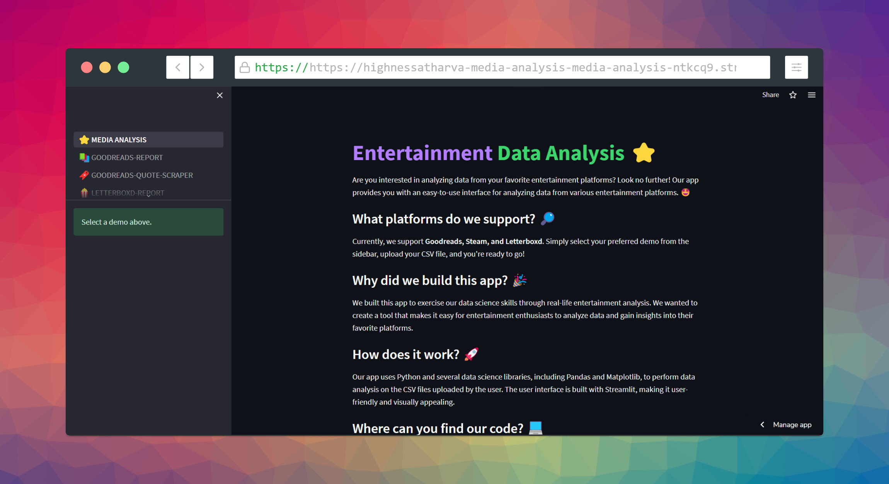
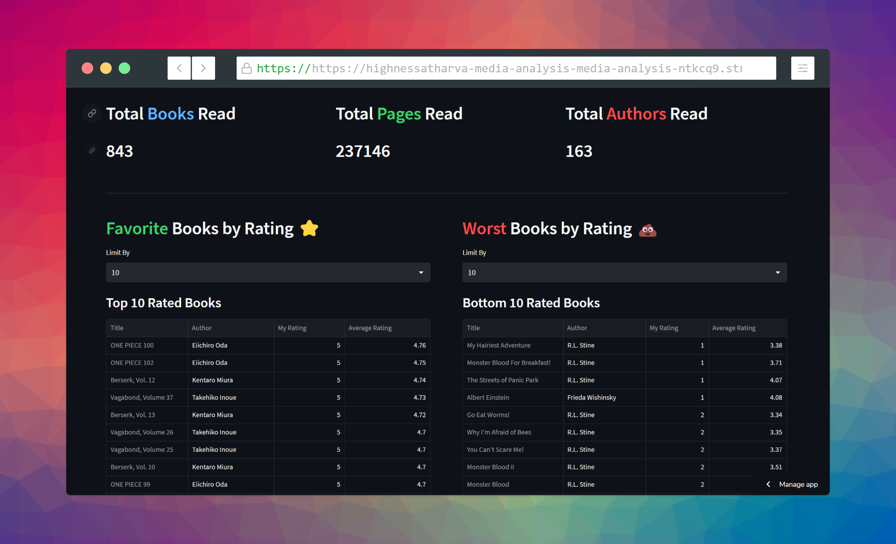
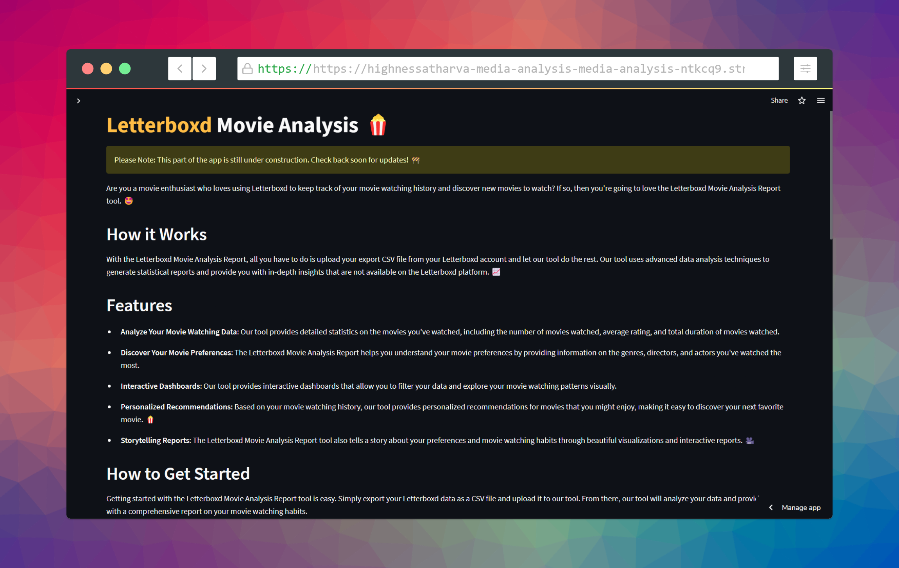
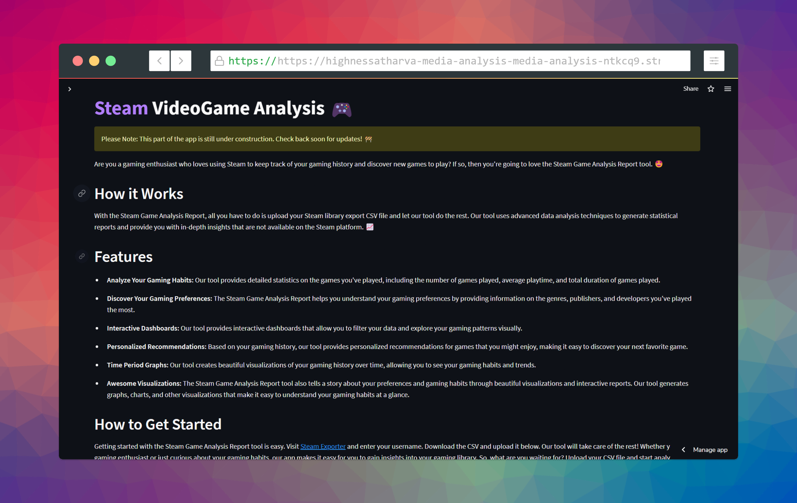
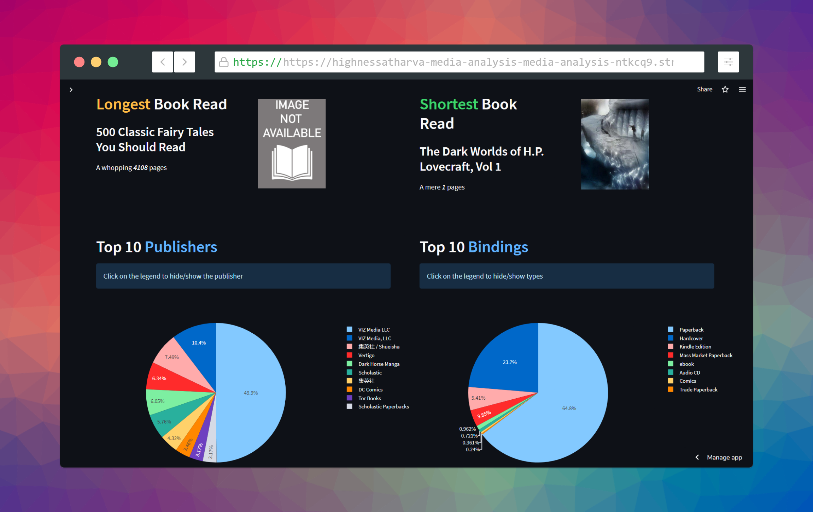
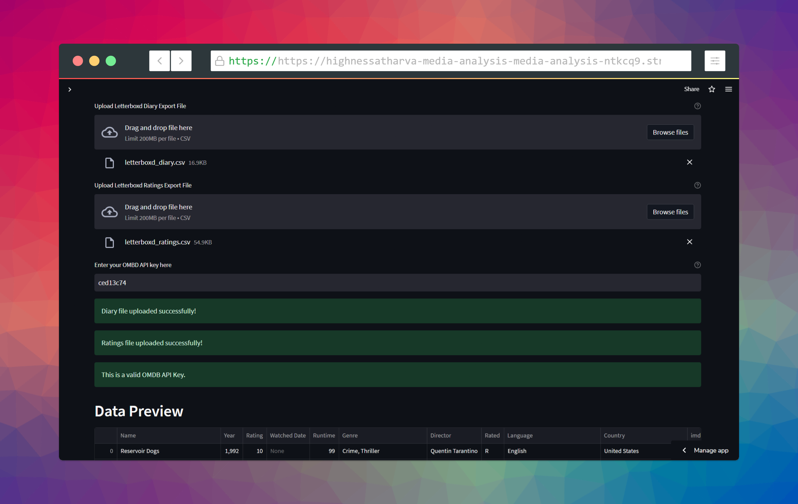
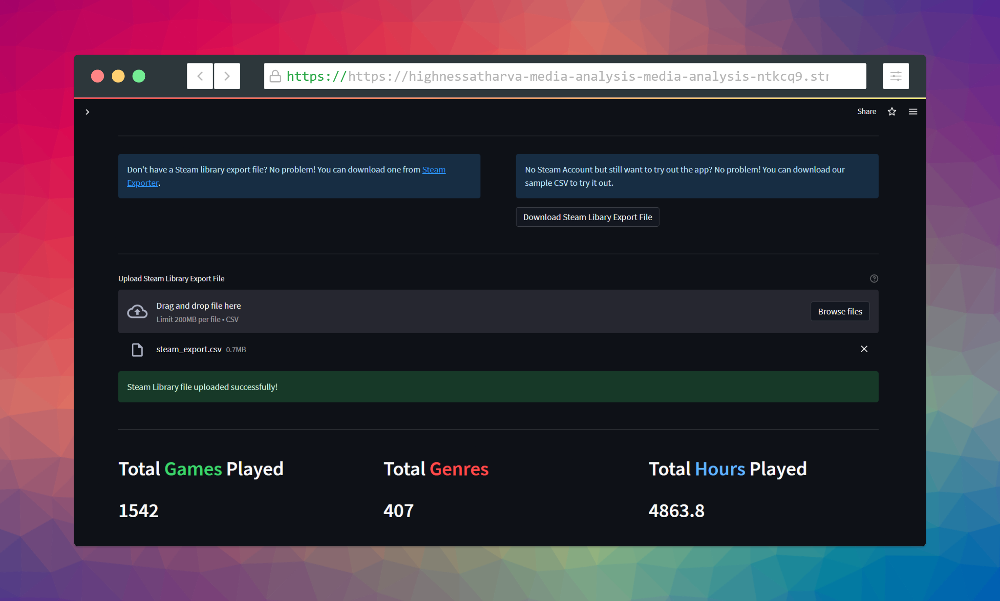

# Entertainment Media Analysis

> A Streamlit app that turns your Goodreads, Letterboxd, and Steam exports into dashboards and insights.




## Overview

Upload your export from a media platform and get back charts, dashboards, and stats about your reading, watching, and gaming habits. Everything runs locally in a Streamlit web app. No account, no upload to a server.

## Supported Platforms

- Goodreads
- Letterboxd
- Steam

## Screenshots

| 📕 Goodreads | 🍿 Letterboxd | 🎮 Steam |
|:-------------------------:|:-------------------------:|:-------------------------:|
| Dashboards |  In-Depth Analysis | Stats |
| | ||

## Getting Started

```bash
git clone https://github.com/HighnessAtharva/Media-Analysis.git
cd Media-Analysis
python -m venv env
env\Scripts\activate        # Windows
# source env/bin/activate   # macOS / Linux
pip install -r requirements.txt
streamlit run app.py
```

Then:

1. Pick a platform from the sidebar
2. Upload your CSV, or use the sample CSVs in `pages/sample-csv`
3. Explore your data

## Project Layout

- `app.py` is the main Streamlit entry point
- `pages/` holds the code and example CSVs for each sub-page in the sidebar

## Contributing

Fork the repo, branch off `main`, commit with clear messages, and open a pull request.

## License

MIT.
